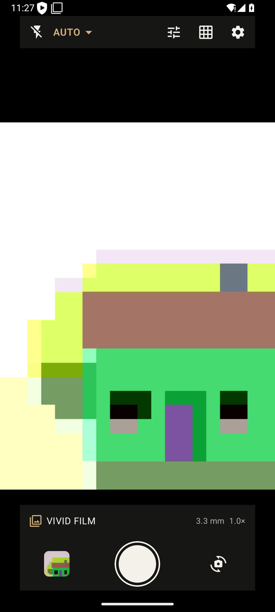

# LUMORA Camera

LUMORA 是一款面向 Android 10 及以上系统的本地摄影应用。可以从取景器拍摄 JPEG，在同一张原图上尝试胶片风格与编辑参数，并在作品库中比较不同版本。

当前公开稳定版为 **v2.1.6（versionCode 10）**，包含此前未单独发布的 2.1.5 数据保全与更新缓存隔离修复。相机权限仅用于取景和拍摄；不授权也能使用作品库和设置。正式下载以 [GitHub Release v2.1.6](https://github.com/yuchen0x1/LUMORA-Camera/releases/tag/v2.1.6) 中通过签名发布流水线的资产为准。`v2.1.0` 是未发布候选标签，历史 [v2.0.0 测试版](https://github.com/yuchen0x1/LUMORA-Camera/releases/tag/v2.0.0) 使用调试证书，均不能直接覆盖为不同签名的正式包；不要为升级自动卸载旧应用。版本变化见[更新记录](CHANGELOG.md)，实际发布状态见[发布历史](RELEASE_HISTORY.md)。



[查看未授权相机时的实际启动页面](docs/screenshots/v2-camera-permission.png)。

## 拍摄与编辑

1. 若要拍照，先点按「开启相机」并授权。点按取景画面进行对焦与测光，使用屏幕快门或启用的音量键拍照。只想查看、导入或编辑照片时，可不授权，直接点按「打开作品库」。
2. 在相机顶部切换模式，打开专业控制可查看当前镜头能调的 ISO、快门、白平衡、手动对焦、变焦及曝光补偿。ISO 与曝光时间是请求值，保存后在作品的诊断信息中核对实际 EXIF。
3. 在拍摄工具中选择 4:3 或 16:9、3 秒或 10 秒倒计时、单张或 3 / 5 张连续拍摄。街拍优先缩短拍摄延迟。厂商 HDR、夜景、人像扩展随镜头和设备而定。
4. 在设置或拍摄工具中选择关闭、三分网格或黄金分割，往返页面和重启后保留选择。打开胶片风格面板选择预设、强度和收藏。拍下第一张照片或从作品库指定样片后，可在同一张照片上比较预设。取景辅助包含网格、水平仪、直方图、明暗警告和峰值提示。
5. 原图与成片分别存入系统媒体库的 `Pictures/LUMORA`。在作品中对比原图、导入照片、调整参数并保存新版本。可撤销编辑步骤，已经保存的上一版本仍可打开。从作品库移除记录会保留媒体文件。

### 作品索引保护

读取时遇到不可读的作品条目不会修改原始索引。下次实际新增、收藏或移除作品而需要重写时，应用会先在同一份私有偏好更新中保留完整原文恢复快照，包括合法 JSON 内被跳过的未知条目；已有恢复快照不覆盖，媒体文件不删除。这是恢复线索保全，不是自动修复，当前没有应用内恢复入口。

## 应用更新

在设置中手动检查 GitHub 正式版，或选择每天/每周自动检查。只有成功检查才记入周期；网络失败后在下次回到前台时按 15 分钟退避重试，手动检查不受退避限制。检查、下载或安装失败会显示可关闭的全局提示，可重新检查后下载。每次下载拥有独立的临时/已校验文件，其他应用实例的下载或清理不会删除它。下载包仍须通过摘要、包名、递增版本码和同证书校验，由 Android 系统确认安装；不会静默安装或自动卸载旧版。

## 从 V1 升级

| 项目 | V1（应用版本 0.1.0） | V2 |
| --- | --- | --- |
| 屏幕 | 竖屏锁定，相机顶部可能碰到状态栏 | 支持旋转，控件按系统安全区布局 |
| 静态成像 | 优先延迟；成片最长边限制在 2400 px | 默认优先质量，记录实际尺寸，成功成片保留输入尺寸 |
| 原图 | 可配置为成片后删除 | 拍摄始终保留原图，处理失败可从作品重试 |
| 镜头和控制 | 固定示例范围，HDR 可用标识 | 按当前镜头能力显示请求范围，支持镜头切换、真实扩展和拍摄辅助 |
| 胶片 | 12 个预设，色块选择 | 20 组参数，保留原 12 个 ID，可用照片预览、收藏、调整强度 |
| 作品 | 原片/成片查看 | 非破坏性编辑、版本关联、收藏、撤销与对比 |

使用同一应用 ID 和签名覆盖安装即可继续访问原作品。旧版曾按用户设置删除的原图无法重建；单文件旧记录会以当时保留下来的照片作为编辑来源。

## 构建与安装

项目使用 Gradle 9.1.0、AGP 9.0.1、Kotlin/Compose 编译插件 2.4.21、CameraX 1.6.2、compileSdk 36 和 targetSdk 35。`settings.gradle.kts` 为已知漏洞依赖设置修复下限，适用于构建、运行与测试工具配置；见[安全审查](SECURITY_AUDIT.md)。本机构建使用 JDK 21；需要安装 Android SDK 与 Build Tools。Windows 中文路径可能触发 AGP/单测路径问题，请在独立纯英文路径构建，不绕过系统执行策略。

```powershell
.\gradlew.bat :app:testDebugUnitTest :app:assembleDebug :app:assembleDebugAndroidTest :app:assembleRelease
adb install -r app/build/outputs/apk/debug/app-debug.apk
```

Debug 安装包位于 `app/build/outputs/apk/debug/app-debug.apk`；本地 Release 输出为 `app/build/outputs/apk/release/app-release-unsigned.apk`，需签名后才能安装。正式发布流程通过受保护的 `android-release` 环境签名，保留证书、版本和摘要校验及签名 APK 的模拟器安装启动检查；本地工程不包含发布密钥。调试测试版不能覆盖安装不同签名的正式版；保留原安装和照片，勿为升级直接卸载。分发规则见[平台与分发](docs/PLATFORMS.md)。首次使用 Gradle Wrapper 会下载固定版本的 Gradle；离线构建需要预先缓存全部依赖。

## 验证资料

[本轮交付报告](docs/EVOLUTION-2.1.6.md) · [新版构图设置真实截图](docs/screenshots/v2.1.6-grid-settings-api29.png) · [验收与性能报告](docs/TEST_REPORT.md) · [历史仪器测试明细](docs/verification/device-results.json) · [实现与数据流](docs/ARCHITECTURE.md) · [版本记录](CHANGELOG.md)

成像诊断可在作品中查看，也可通过 `adb logcat -s LumoraCapture` 读取。当前导出格式为 JPEG。模拟器验证与实体设备验收范围详见报告。
